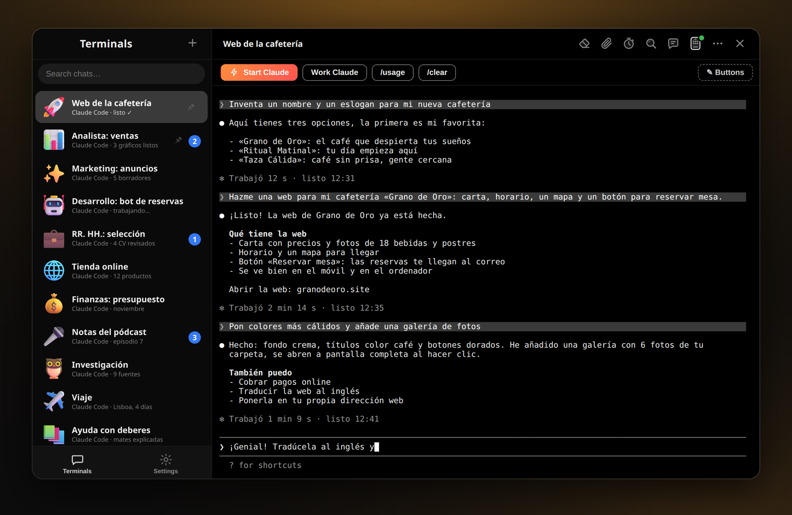
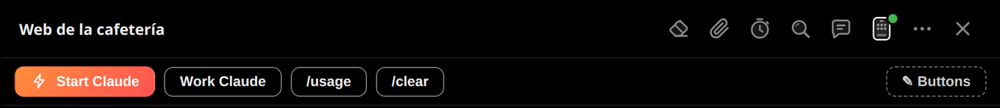
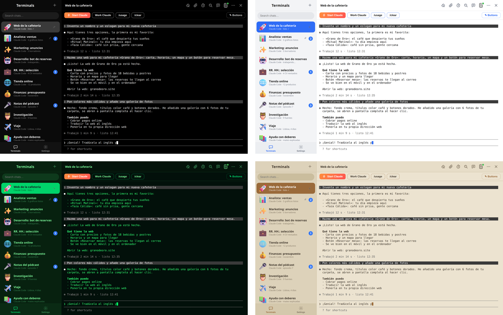

<p align="center">
  <a href="https://arsminal.com/es/"></a>
</p>

<h1 align="center">Arsminal</h1>

<p align="center">
  <b>La mensajería para tu equipo de agentes de IA.</b><br>
  Cada sesión de Claude Code es un chat. Chats a la izquierda, la conversación a la derecha.<br>
  Gratis para macOS, Windows y Linux.
</p>

<p align="center">
  <a href="https://github.com/arsentev-ai/arsminal/releases/latest"></a>
  <a href="https://github.com/arsentev-ai/arsminal/releases"></a>
  <a href="https://github.com/arsentev-ai/arsminal/releases/latest"></a>
  <a href="LICENSE.txt"></a>
  <a href="https://github.com/arsentev-ai/arsminal/stargazers"></a>
</p>

<p align="center">
  <a href="https://arsminal.com/es/"><b>Web</b></a> &nbsp;·&nbsp;
  <a href="https://github.com/arsentev-ai/arsminal/releases/latest"><b>Descargar</b></a> &nbsp;·&nbsp;
  <a href="#-descargar"><b>Todas las plataformas</b></a> &nbsp;·&nbsp;
  <a href="#-preguntas-frecuentes"><b>Preguntas</b></a>
</p>

<p align="center">
  <a href="README.md">English</a> &nbsp;·&nbsp; <a href="README.ru.md">Русский</a> &nbsp;·&nbsp; <b>Español</b>
</p>

<p align="center">
  <a href="https://arsminal.com/es/"></a>
</p>

<br>

## 💬 Por qué una mensajería

Arsminal es una aplicación de escritorio que se ve y se siente como una mensajería, pero dentro de cada chat hay un terminal de verdad con un agente de IA. Trabajas con tus agentes igual que escribes a tus compañeros: la lista de chats a la izquierda, la conversación a la derecha. Sin montones de ventanas de terminal ni el desorden de los editores de código. Escribe o habla, los agentes hacen el trabajo.

> **Del autor.** En una gran empresa tenía en mi mensajería a todos los departamentos: marketing, un analista, un desarrollador, RR. HH. En una startup hay menos gente y menos presupuesto, así que me quedé con la mensajería y di los mismos roles a agentes. Arsminal es esa mensajería: un chat por agente, un agente por rol o proyecto. Lo hice primero para mí. Ahora es gratis para todos.

<br>

## 👥 Un equipo de agentes, cada uno en su chat


Cada agente tiene su propio chat con nombre, rol y un sticker 3D: **Analista: ventas**, **Marketing: anuncios**, **Desarrollo: bot de reservas**, **RR. HH.: selección**, **Finanzas: presupuesto**. Todos pueden ser Claude Code, cada uno en su carpeta de proyecto. Trabajan a la vez sin estorbarse, y pasas de uno a otro como entre compañeros en una mensajería.

- **Cada chat es un terminal vivo.** Arsminal ejecuta el Claude Code oficial con tu propia cuenta. Nada pasa por intermediarios ni está reimplementado.
- **Ves quién trabaja, quién ha terminado y quién espera.** Cuando un agente en un chat de fondo termina o te pregunta algo, ese chat sube arriba con un contador de no leídos.
- **Fijados, archivo y búsqueda.** Fija los chats importantes, manda los viejos al archivo, encuentra cualquier conversación por una palabra.
- **Proyectos, no solo código.** Una web, un informe de ventas, borradores de anuncios, selección de personal, un pódcast, un viaje: todo lo que un agente puede hacer por ti es un chat.

<br clear="right">

## 🎤 Dilo en vez de escribirlo

Pulsa el micrófono y di lo que necesitas, como si grabaras una nota de voz. El agente lo recibe como texto y se pone a trabajar. La voz se reconoce en tu propio ordenador, la grabación no sale de él.

## ⏰ Mensajes programados

Escribe ahora, envía después. El agente recibe la tarea mañana a las 9:00, aunque estés durmiendo.

## ⚡ Botones en vez de comandos

<p align="center">
  
</p>

Guarda las peticiones frecuentes como botones. Un toque y el agente tiene la tarea. Puedes añadirlos, renombrarlos y cambiarles el color. Adjuntar un archivo funciona como en cualquier mensajería: clip, elegir el archivo, enviar.

## 📱 Tus agentes en el móvil

Escanea un código QR y sigue trabajando con todo el equipo desde un café o un parque. Los chats se mantienen sincronizados: empieza en el ordenador, continúa desde el móvil. Sin app aparte, funciona en el navegador.

La conexión está **cifrada de extremo a extremo con ML-KEM-768 poscuántico sobre X25519**. El servidor solo pasa bytes que no puede leer y no apunta nada. Lo que se intercepte hoy no podrán abrirlo ni los ordenadores del futuro.

## 🎨 Temas para el día y la noche

<p align="center">
  
</p>

Negro para la noche, blanco para el día, Matrix verde y un tema beige tranquilo para ojos cansados. 12 temas en total, tu propio fondo detrás de cualquier chat y el modo **Auto**: claro de día, oscuro de noche, cambia solo.

## 🔒 Lo tuyo sigue siendo tuyo

- **Tus chats contigo.** Conversaciones, archivos y claves se guardan solo en tu ordenador.
- **Extremo a extremo hasta el móvil.** ML-KEM, el estándar NIST de 2024. El servidor no ve nada.
- **Sin rastreo.** Sin analítica, sin anuncios, sin venta de datos. Nunca.

<br>

## 📥 Descargar

Arsminal es totalmente gratis. Sin anuncios ni suscripción.

| Plataforma | Archivo | Dónde |
|---|---|---|
| 🍎 **macOS** · Apple Silicon | `Arsminal-<versión>-arm64.dmg` | [Última versión](https://github.com/arsentev-ai/arsminal/releases/latest) · [arsminal.com/es](https://arsminal.com/es/) |
| 🍎 **macOS** · Intel | `Arsminal-<versión>-x64.dmg` | [Última versión](https://github.com/arsentev-ai/arsminal/releases/latest) · [arsminal.com/es](https://arsminal.com/es/) |
| 🪟 **Windows** | `Arsminal-Setup-<versión>.exe` | [Última versión](https://github.com/arsentev-ai/arsminal/releases/latest) · [arsminal.com/es](https://arsminal.com/es/) |
| 🐧 **Linux** x86_64 | `Arsminal-<versión>-x86_64.AppImage` | [Última versión](https://github.com/arsentev-ai/arsminal/releases/latest) · [arsminal.com/es](https://arsminal.com/es/) |

**macOS con Homebrew:**  

```sh
brew install --cask arsentev-ai/tap/arsminal
```

**Consejo para Windows.** Si SmartScreen muestra un aviso azul al abrirlo por primera vez, pulsa **Más información → Ejecutar de todas formas** (More info → Run anyway). El instalador es el mismo archivo de la versión de arriba.

**Linux.** Da permisos de ejecución al AppImage (`chmod +x`) y ábrelo. Las actualizaciones llegan dentro de la app.

<br>

## ❓ Preguntas frecuentes

**¿Arsminal es gratis de verdad?**  
Sí. Totalmente gratis, sin anuncios ni suscripción.

**¿Los agentes vienen incluidos?**  
No. Arsminal es la mensajería; los agentes son tuyos. Instala Claude Code como siempre con tu propia cuenta de Claude, pulsa **Start Claude** en un chat y ahí se ejecuta.

**¿Qué agentes funcionan?**  
Claude Code ante todo. También cualquier agente que se ejecute en un terminal: OpenAI Codex, Gemini, Grok, DeepSeek, Cursor, GitHub Copilot y agentes locales en tu propio ordenador.

**¿Por qué muchos agentes y no uno?**  
Por lo mismo que una empresa tiene más de un empleado. Un agente por rol o proyecto: marketing, análisis, desarrollo. Trabajan a la vez, y ves quién ha terminado y quién te espera.

**¿Dónde se guardan mis conversaciones?**  
Solo en tu ordenador. La conexión con el móvil está cifrada de extremo a extremo y el servidor no puede leerla.

**¿Necesito saber programar?**  
No. Escribes o dices lo que necesitas con palabras normales, el agente escribe el código.

**¿Windows, Linux, móvil?**  
macOS, Windows y Linux a la vez. El móvil se conecta con un código QR en el navegador, sin app aparte.

<br>

## 🔗 Enlaces

- **Web:** [arsminal.com/es](https://arsminal.com/es/) · [English](https://arsminal.com) · [Русский](https://arsminal.com/ru/)
- **Comparativas:** [Arsminal como alternativa a cmux](https://arsminal.com/cmux-alternative/) · [Arsminal como alternativa a Warp](https://arsminal.com/warp-alternative/) · [El mejor terminal para Claude Code](https://arsminal.com/best-terminal-for-claude-code/)
- **Versiones:** [github.com/arsentev-ai/arsminal/releases](https://github.com/arsentev-ai/arsminal/releases)
- **Política de privacidad:** [arsminal.com/privacy](https://arsminal.com/privacy)

## 👤 Autor


**Evgenii Arsentev**, MD, PhD — creador de Arsminal; fundador y CEO de Dad4Kids y [arsentev.ai](https://arsentev.ai).  
Trabajo con agentes de IA cada día e hice Arsminal primero para mí.

[arsentev.ai](https://arsentev.ai) · [Wikidata](https://www.wikidata.org/wiki/Q141398931) · [ORCID](https://orcid.org/0000-0002-9120-7298) · [DOI 10.5281/zenodo.24079643](https://doi.org/10.5281/zenodo.24079643)

<br clear="left">

## 📄 Licencia

Arsminal es **freeware**: gratis para descargar y usar, pero no es de código abierto. Consulta [LICENSE.txt](LICENSE.txt).

© 2026 Evgenii Arsentev. Todos los derechos reservados.  
Claude, Codex, Gemini, Grok, DeepSeek, Cursor y Copilot son marcas de sus propietarios. Arsminal no está afiliado a ellos.

<p align="center">
  <sub>Si Arsminal te resulta útil, una ⭐ en este repositorio ayuda a que otros lo encuentren.</sub>
</p>
