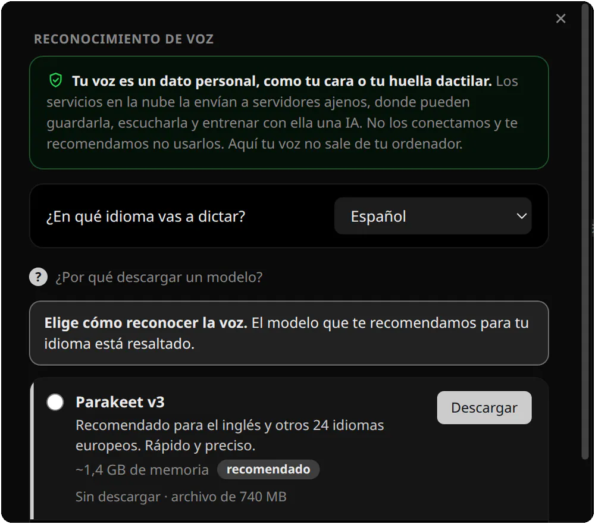
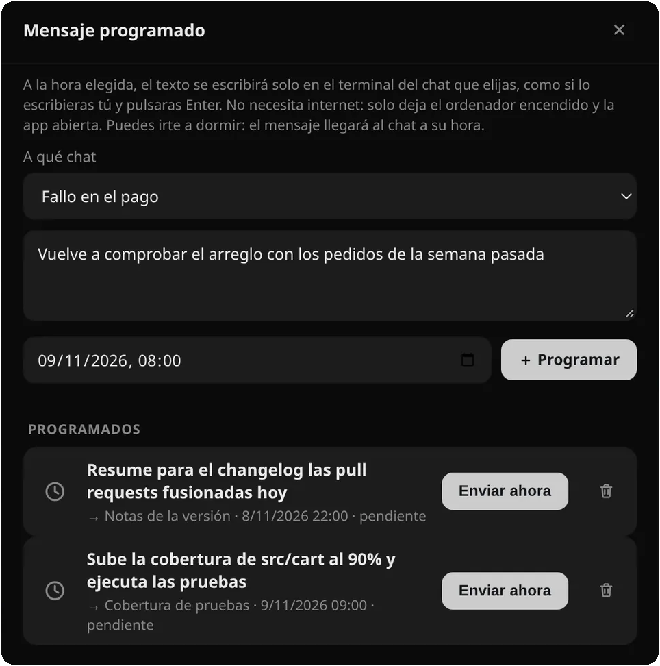
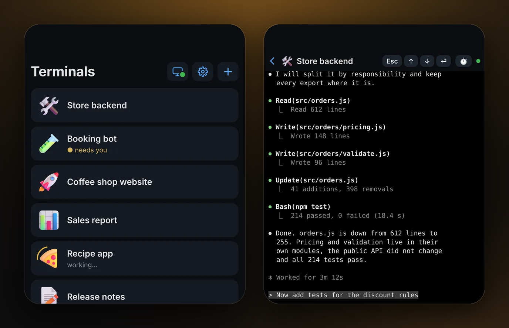
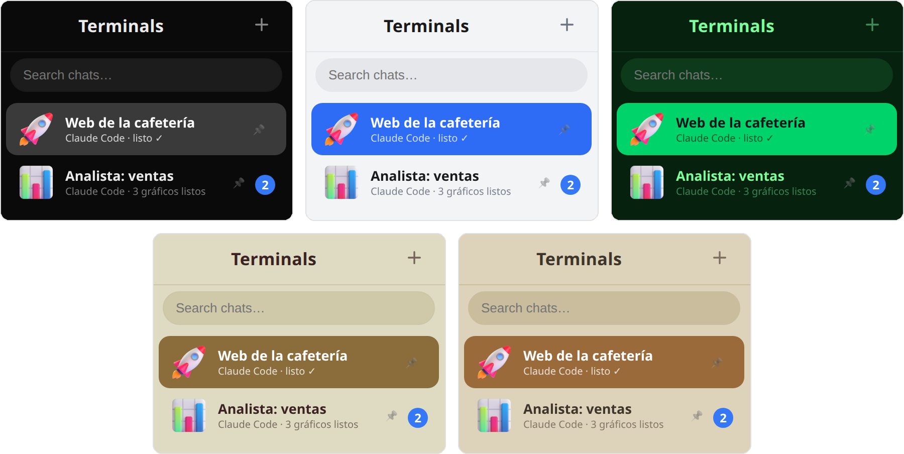

<!-- En cada nueva versión cambia el número en todos los enlaces /dl/v1.0.3/ (botones de descarga, tabla de Descargar). El contador /dl/ redirige al mismo archivo en GitHub Releases. -->
<p align="center">
  <a href="https://arsminal.com/es/"></a>
</p>

<h1 align="center">Arsminal</h1>

<p align="center">
  <b>La mensajería para tu equipo de agentes de IA</b>
</p>

<p align="center">
  Cada sesión de Claude Code es un chat. Chats a la izquierda, la conversación a la derecha.<br>
  Gratis para macOS, Windows y Linux.
</p>

<p align="center">
  <a href="https://arsminal.com/dl/v1.0.3/Arsminal-1.0.3-arm64-es.dmg?s=gh"></a>&nbsp;
  <a href="https://arsminal.com/dl/v1.0.3/Arsminal-Setup-1.0.3-es.exe?s=gh"></a>&nbsp;
  <a href="https://arsminal.com/dl/v1.0.3/Arsminal-1.0.3-x86_64-es.AppImage?s=gh"></a>
</p>
<p align="center">
  <sub>El botón de macOS es para Apple Silicon · <a href="https://arsminal.com/dl/v1.0.3/Arsminal-1.0.3-x64-es.dmg?s=gh">Intel</a> · <a href="https://github.com/arsentev-ai/arsminal/releases">todas las versiones</a></sub>
</p>

<p align="center">
  <a href="https://github.com/arsentev-ai/arsminal/releases"></a>
  <a href="https://github.com/arsentev-ai/arsminal/releases"></a>
  <a href="#-descargar"></a>
  <a href="LICENSE.txt"></a>
  <a href="https://github.com/arsentev-ai/arsminal/stargazers"></a>
</p>

<p align="center">
  <a href="https://arsminal.com/es/"><b>Web</b></a> &nbsp;·&nbsp;
  <a href="#-funciones"><b>Funciones</b></a> &nbsp;·&nbsp;
  <a href="#-descargar"><b>Descargar</b></a> &nbsp;·&nbsp;
  <a href="#-preguntas-frecuentes"><b>Preguntas</b></a>
</p>

<p align="center">
  <a href="README.md">English</a> &nbsp;·&nbsp; <a href="README.ru.md">Русский</a> &nbsp;·&nbsp; <b>Español</b>
</p>

<p align="center">
  <a href="https://arsminal.com/es/"></a>
</p>

<br>

## 💬 Qué es

Arsminal es una aplicación de escritorio que se ve y se siente como una mensajería, pero dentro de cada chat hay un terminal de verdad con un agente de IA. Trabajas con tus agentes igual que escribes a tus compañeros: la lista de chats a la izquierda, la conversación a la derecha. Sin montones de ventanas de terminal ni el desorden de los editores de código. Escribe o habla, los agentes hacen el trabajo.

## 🧭 Por qué lo hice

**En una gran empresa, mi mensajería tenía a todos los departamentos.** Marketing, un analista, un desarrollador, RR. HH.: cada uno era un chat, y de un vistazo sabía quién había terminado y quién me esperaba.

**En una startup hay menos gente y menos presupuesto.** Así que me quedé con la mensajería y di los mismos roles a agentes: un Claude Code para el análisis, otro para los anuncios, otro para el bot de reservas, otro para la selección de personal. Trabajan a la vez, cada uno en su carpeta de proyecto, y paso de uno a otro como entre compañeros.

**Arsminal es esa mensajería.** Un chat por agente, un agente por rol o proyecto. Lo hice primero para mí. Ahora es gratis para todos.

<br>

## ✨ Funciones

<table>
<tr>
<td width="40%" valign="middle">
<h3>👥 Un equipo de agentes, cada uno en su chat</h3>
<b>Analista: ventas</b>, <b>Marketing: anuncios</b>, <b>Desarrollo: bot de reservas</b>, <b>RR. HH.: selección</b>. Cada uno es Claude Code en su propia carpeta de proyecto, con nombre, rol y un sticker 3D.
</td>
<td width="60%">

</td>
</tr>
<tr>
<td width="40%" valign="middle">
<h3>🔔 Quién trabaja, quién ha terminado, quién espera</h3>
El estado está justo debajo del nombre: <i>trabajando…</i>, <i>listo ✓</i>, <i>3 gráficos listos</i>. Cuando un agente en un chat de fondo termina o te pregunta algo, ese chat sube arriba con un contador de no leídos.
</td>
<td width="60%">

</td>
</tr>
<tr>
<td width="40%" valign="middle">
<h3>⚡ Botones en vez de comandos</h3>
Guarda las peticiones frecuentes como botones: <b>Start Claude</b>, <b>/usage</b>, <b>/clear</b> o los tuyos. Un toque y el agente tiene la tarea. Puedes añadirlos, renombrarlos y cambiarles el color.
</td>
<td width="60%">

</td>
</tr>
<tr>
<td width="40%" valign="middle">
<h3>🎤 Dilo en vez de escribirlo</h3>
Pulsa el micrófono y habla, como si grabaras una nota de voz. El agente lo recibe como texto y se pone a trabajar. La voz la reconoce un modelo en tu propio ordenador; la grabación no sale de él.
</td>
<td width="60%">

</td>
</tr>
<tr>
<td width="40%" valign="middle">
<h3>⏰ Mensajes programados</h3>
Escribe ahora, envía después. A la hora que fijes, el texto se escribe solo en el chat elegido, como si lo hubieras tecleado y pulsado Enter. El agente recibe la tarea mañana a las 9:00, aunque estés durmiendo.
</td>
<td width="60%">

</td>
</tr>
<tr>
<td width="40%" valign="middle">
<h3>📱 Tus agentes en el móvil</h3>
Escanea un código QR y sigue trabajando con todo el equipo desde un café o un parque. La app para el móvil es gratis y sin cuenta: <a href="https://arsminal.com/es/app">iPhone — App Store, Android — APK</a>. La conexión está cifrada de extremo a extremo con <b>ML-KEM-768</b> poscuántico sobre X25519.
</td>
<td width="60%">

</td>
</tr>
<tr>
<td width="40%" valign="middle">
<h3>🎨 Temas para el día y la noche</h3>
12 temas, tu propio fondo detrás de cualquier chat y el modo <b>Auto</b>: claro de día, oscuro de noche, cambia solo.
</td>
<td width="60%">

</td>
</tr>
</table>

- **Cada chat es un terminal vivo.** Arsminal ejecuta el Claude Code oficial con tu propia cuenta. Nada pasa por intermediarios ni está reimplementado.
- **Fijados, archivo y búsqueda.** Fija los chats importantes, manda los viejos al archivo, encuentra cualquier conversación por una palabra.
- **Archivos como en una mensajería.** Clip, elegir el archivo, enviar. El agente lo recibe en el chat.
- **Proyectos, no solo código.** Una web, un informe de ventas, borradores de anuncios, selección de personal, un pódcast, un viaje: todo lo que un agente puede hacer por ti es un chat.
- **Gratis.** Sin anuncios ni suscripción. Las actualizaciones llegan dentro de la app.

<br>

## 🎨 Temas

<p align="center">
  
</p>

Negro para la noche, blanco para el día, Matrix verde, beige cálido y un tema tranquilo para ojos cansados. 12 temas en total, y en el modo **Auto** la app es clara de día y oscura de noche por sí sola.

<br>

## 🔒 Lo tuyo sigue siendo tuyo

- **Tus chats contigo.** Conversaciones, archivos y claves se guardan solo en tu ordenador.
- **Extremo a extremo hasta el móvil.** ML-KEM, el estándar NIST de 2024. El servidor solo pasa bytes que no puede leer y no apunta nada.
- **Sin rastreo.** Sin analítica, sin anuncios, sin venta de datos. Nunca.

<br>

## 📥 Descargar

<p align="center">
  <a href="https://arsminal.com/dl/v1.0.3/Arsminal-1.0.3-arm64-es.dmg?s=gh"></a>&nbsp;
  <a href="https://arsminal.com/dl/v1.0.3/Arsminal-Setup-1.0.3-es.exe?s=gh"></a>&nbsp;
  <a href="https://arsminal.com/dl/v1.0.3/Arsminal-1.0.3-x86_64-es.AppImage?s=gh"></a>
</p>
<p align="center">
  <sub>El botón de macOS es para Apple Silicon · <a href="https://arsminal.com/dl/v1.0.3/Arsminal-1.0.3-x64-es.dmg?s=gh">Intel</a> · <a href="https://github.com/arsentev-ai/arsminal/releases">todas las versiones</a></sub>
</p>

Arsminal es totalmente gratis. Sin anuncios ni suscripción.

| Plataforma | Archivo | Dónde |
|---|---|---|
| 🍎 **macOS** · Apple Silicon | `Arsminal-1.0.3-arm64-es.dmg` | [Descargar](https://arsminal.com/dl/v1.0.3/Arsminal-1.0.3-arm64-es.dmg?s=gh) · [todas las versiones](https://github.com/arsentev-ai/arsminal/releases) |
| 🍎 **macOS** · Intel | `Arsminal-1.0.3-x64-es.dmg` | [Descargar](https://arsminal.com/dl/v1.0.3/Arsminal-1.0.3-x64-es.dmg?s=gh) · [todas las versiones](https://github.com/arsentev-ai/arsminal/releases) |
| 🪟 **Windows** | `Arsminal-Setup-1.0.3-es.exe` | [Descargar](https://arsminal.com/dl/v1.0.3/Arsminal-Setup-1.0.3-es.exe?s=gh) · [todas las versiones](https://github.com/arsentev-ai/arsminal/releases) |
| 🐧 **Linux** x86_64 | `Arsminal-1.0.3-x86_64-es.AppImage` | [Descargar](https://arsminal.com/dl/v1.0.3/Arsminal-1.0.3-x86_64-es.AppImage?s=gh) · [todas las versiones](https://github.com/arsentev-ai/arsminal/releases) |
| 📱 **Móvil** · iPhone, Android | App Store · APK | [arsminal.com/es/app](https://arsminal.com/es/app) |

<p align="center">
  <a href="https://arsminal.com/es/app"></a>
</p>

**Móvil.** [iPhone — App Store, Android — APK](https://arsminal.com/es/app): un mando a distancia para los agentes de tu ordenador. Gratis, sin cuenta, se empareja con un código QR.

**macOS con Homebrew**

```sh
brew install --cask arsentev-ai/tap/arsminal
```

**Consejo para Windows.** Si SmartScreen muestra un aviso azul al abrirlo por primera vez, pulsa **Más información → Ejecutar de todas formas** (More info → Run anyway). El instalador es el mismo archivo de la versión de arriba.

**Linux.** Da permisos de ejecución al AppImage (`chmod +x`) y ábrelo. Las actualizaciones llegan dentro de la app.

<br>

## ❓ Preguntas frecuentes

<details>
<summary><b>¿Arsminal es gratis de verdad?</b></summary>
<br>
Sí. Totalmente gratis, sin anuncios ni suscripción.
</details>

<details>
<summary><b>¿Los agentes vienen incluidos?</b></summary>
<br>
No. Arsminal es la mensajería; los agentes son tuyos. Instala Claude Code como siempre con tu propia cuenta de Claude, pulsa <b>Start Claude</b> en un chat y ahí se ejecuta.
</details>

<details>
<summary><b>¿Qué agentes funcionan?</b></summary>
<br>
Claude Code ante todo. También cualquier agente que se ejecute en un terminal: OpenAI Codex, Gemini, Grok, DeepSeek, Cursor, GitHub Copilot y agentes locales en tu propio ordenador.
</details>

<details>
<summary><b>¿Por qué muchos agentes y no uno?</b></summary>
<br>
Por lo mismo que una empresa tiene más de un empleado. Un agente por rol o proyecto: marketing, análisis, desarrollo. Trabajan a la vez, y ves quién ha terminado y quién te espera.
</details>

<details>
<summary><b>¿Dónde se guardan mis conversaciones?</b></summary>
<br>
Solo en tu ordenador. La conexión con el móvil está cifrada de extremo a extremo y el servidor no puede leerla.
</details>

<details>
<summary><b>¿Necesito saber programar?</b></summary>
<br>
No. Escribes o dices lo que necesitas con palabras normales, el agente escribe el código.
</details>

<details>
<summary><b>¿Windows, Linux, móvil?</b></summary>
<br>
macOS, Windows y Linux a la vez. El móvil tiene su propia app: iPhone desde el App Store, Android como APK. Se empareja con el ordenador por código QR.
</details>

<br>

## 🔗 Enlaces

- **Web:** [arsminal.com/es](https://arsminal.com/es/) · [English](https://arsminal.com) · [Русский](https://arsminal.com/ru/)
- **Comparativas:** [Arsminal como alternativa a cmux](https://arsminal.com/cmux-alternative/) · [Arsminal como alternativa a Warp](https://arsminal.com/warp-alternative/) · [El mejor terminal para Claude Code](https://arsminal.com/best-terminal-for-claude-code/)
- **Versiones:** [github.com/arsentev-ai/arsminal/releases](https://github.com/arsentev-ai/arsminal/releases)
- **Política de privacidad:** [arsminal.com/privacy](https://arsminal.com/privacy)

## 👤 Autor


**Evgenii Arsentev**, MD, PhD — creador de Arsminal; fundador y CEO de Dad4Kids y [arsentev.ai](https://arsentev.ai).  
Trabajo con agentes de IA cada día e hice Arsminal primero para mí.

[arsentev.ai](https://arsentev.ai) · [Wikidata](https://www.wikidata.org/wiki/Q141398931) · [ORCID](https://orcid.org/0000-0002-9120-7298) · [DOI 10.5281/zenodo.24079643](https://doi.org/10.5281/zenodo.24079643)

<br clear="left">

## 📄 Licencia

Arsminal es **freeware**: gratis para descargar y usar, pero no es de código abierto. Consulta [LICENSE.txt](LICENSE.txt).

© 2026 Evgenii Arsentev. Todos los derechos reservados.  
Claude, Codex, Gemini, Grok, DeepSeek, Cursor y Copilot son marcas de sus propietarios. Arsminal no está afiliado a ellos.

<p align="center">
  <sub>Si Arsminal te resulta útil, una ⭐ en este repositorio ayuda a que otros lo encuentren.</sub>
</p>
