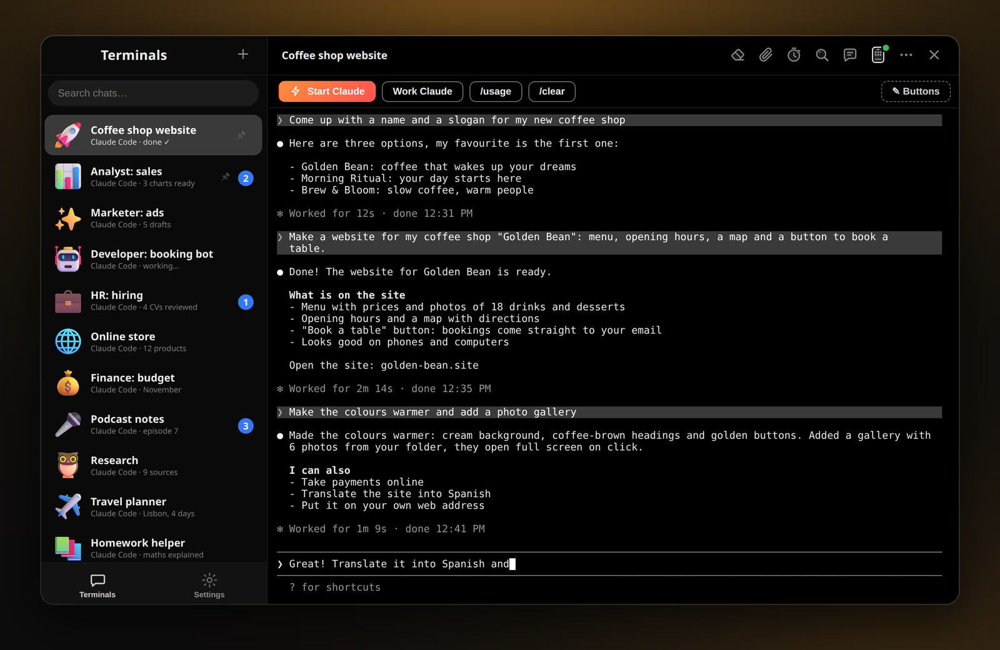
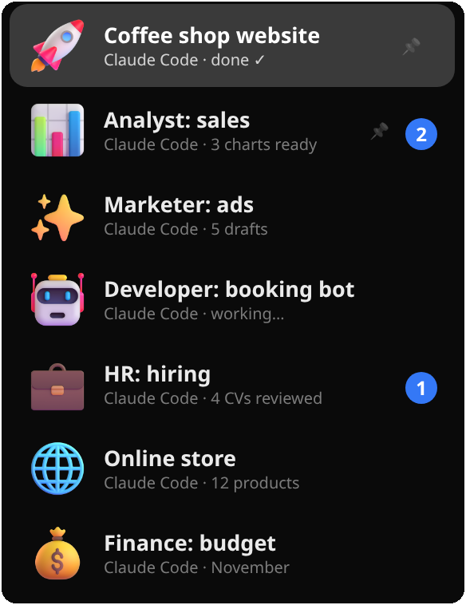
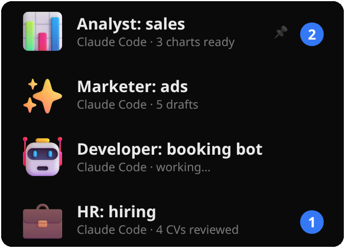
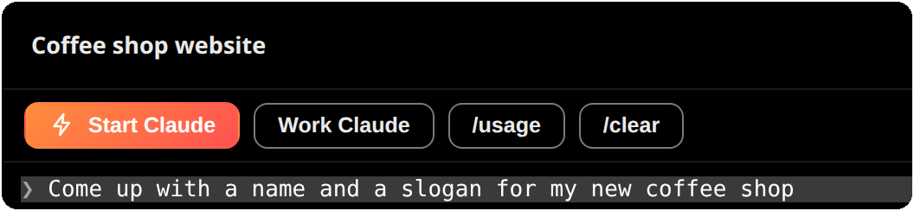
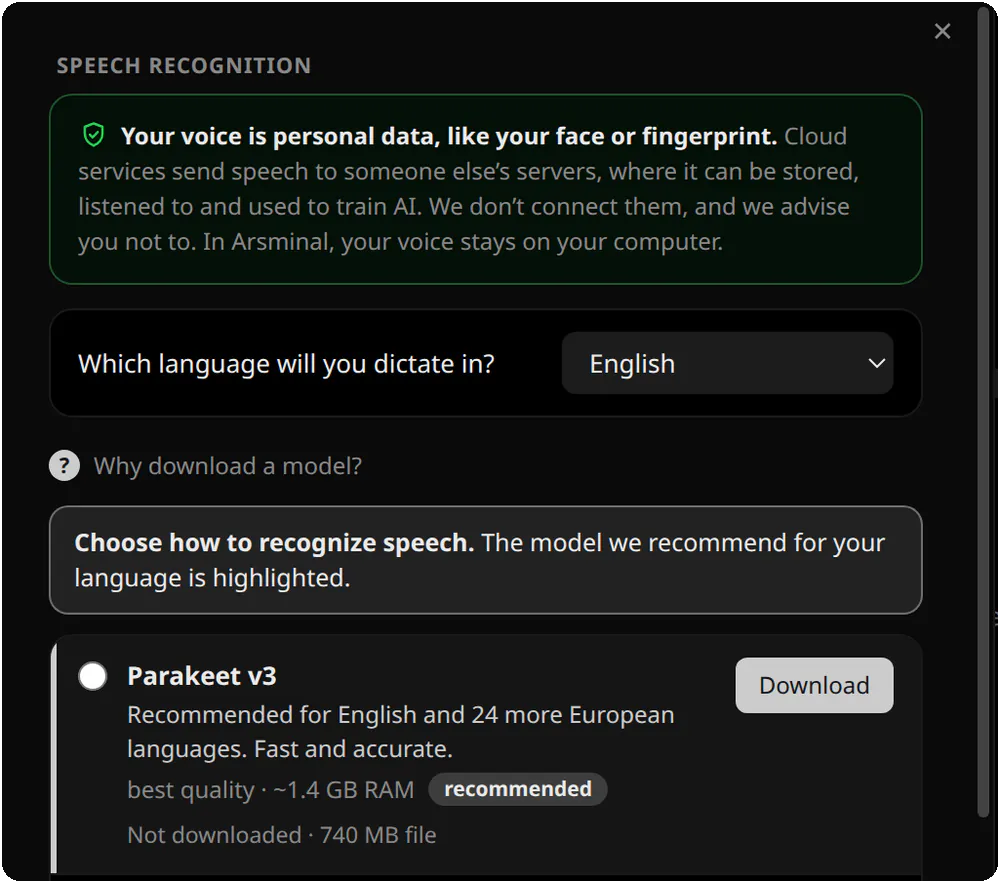
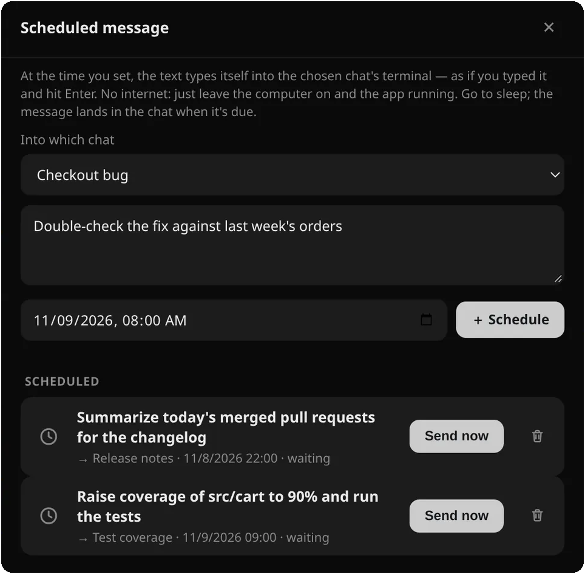
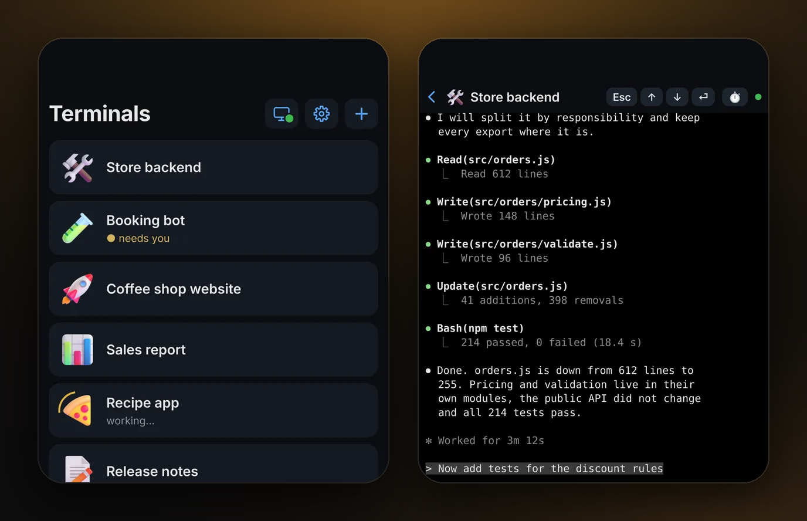
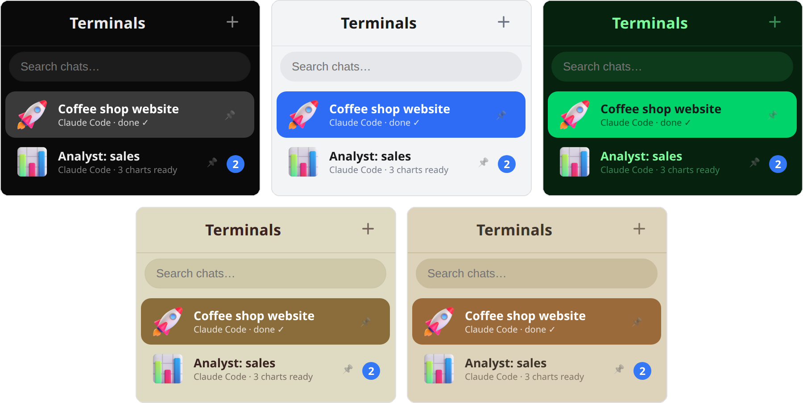
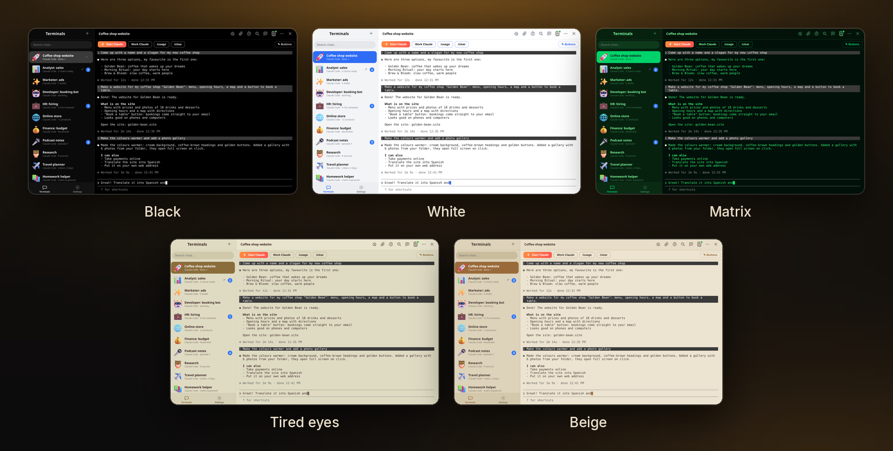

<!-- On every new release change the version in all /dl/v1.0.3/ links (download buttons, the Download table). The /dl/ counter redirects to the same file on GitHub Releases. -->
<p align="center">
  <a href="https://arsminal.com"></a>
</p>

<h1 align="center">Arsminal</h1>

<p align="center">
  <b>The messenger for your team of AI agents</b>
</p>

<p align="center">
  Every Claude Code session is a chat. Chats on the left, the conversation on the right.<br>
  Free for macOS, Windows and Linux.
</p>

<p align="center">
  <a href="https://arsminal.com/dl/v1.0.3/Arsminal-1.0.3-arm64-en.dmg?s=gh"></a>&nbsp;
  <a href="https://arsminal.com/dl/v1.0.3/Arsminal-Setup-1.0.3-en.exe?s=gh"></a>&nbsp;
  <a href="https://arsminal.com/dl/v1.0.3/Arsminal-1.0.3-x86_64-en.AppImage?s=gh"></a>
</p>
<p align="center">
  <sub>The macOS button is for Apple Silicon · <a href="https://arsminal.com/dl/v1.0.3/Arsminal-1.0.3-x64-en.dmg?s=gh">Intel Mac</a> · <a href="https://github.com/arsentev-ai/arsminal/releases">all versions</a></sub>
</p>

<p align="center">
  <a href="https://github.com/arsentev-ai/arsminal/releases"></a>
  <a href="https://github.com/arsentev-ai/arsminal/releases"></a>
  <a href="#-download"></a>
  <a href="LICENSE.txt"></a>
  <a href="https://github.com/arsentev-ai/arsminal/stargazers"></a>
</p>

<p align="center">
  <a href="https://arsminal.com"><b>Website</b></a> &nbsp;·&nbsp;
  <a href="#-features"><b>Features</b></a> &nbsp;·&nbsp;
  <a href="#-download"><b>Download</b></a> &nbsp;·&nbsp;
  <a href="#-faq"><b>FAQ</b></a>
</p>

<p align="center">
  <b>English</b> &nbsp;·&nbsp; <a href="README.ru.md">Русский</a> &nbsp;·&nbsp; <a href="README.es.md">Español</a>
</p>

<p align="center">
  <a href="https://arsminal.com"></a>
</p>

<br>

## 💬 What it is

Arsminal is a desktop app that looks and feels like a messenger, but under the hood every chat is a real terminal with an AI agent in it. You work with your agents the way you text colleagues: a list of chats on the left, the conversation on the right. No pile of terminal windows, no clutter of code editors. Type or just talk, the agents do the work.

## 🧭 Why I built it

**In a big company, my messenger had every department in it.** A marketer, an analyst, a developer, HR: each one a chat, and I knew at a glance who was done and who was waiting for me.

**In a startup there are fewer people and less budget.** So I kept the messenger and gave the same roles to agents: a Claude Code for analytics, a Claude Code for ads, a Claude Code for the booking bot, a Claude Code for hiring. They work at the same time, each in its own project folder, and I move between them like between colleagues.

**Arsminal is that messenger.** One chat per agent, one agent per role or project. I built it for myself first. Now it is free for everyone.

<br>

## ✨ Features

<table>
<tr>
<td width="40%" valign="middle">
<h3>👥 A team of agents, one chat each</h3>
<b>Analyst: sales</b>, <b>Marketer: ads</b>, <b>Developer: booking bot</b>, <b>HR: hiring</b>. Each is Claude Code in its own project folder, with a name, a role and a 3D sticker.
</td>
<td width="60%">

</td>
</tr>
<tr>
<td width="40%" valign="middle">
<h3>🔔 Who is working, who is done, who is waiting</h3>
The status is right under the name: <i>working…</i>, <i>done ✓</i>, <i>3 charts ready</i>. When an agent in a background chat finishes or asks you something, that chat moves to the top with an unread badge.
</td>
<td width="60%">

</td>
</tr>
<tr>
<td width="40%" valign="middle">
<h3>⚡ Buttons instead of commands</h3>
Save the requests you make often as buttons: <b>Start Claude</b>, <b>/usage</b>, <b>/clear</b> or your own. One tap and the agent has the task. Add, rename and recolor them yourself.
</td>
<td width="60%">

</td>
</tr>
<tr>
<td width="40%" valign="middle">
<h3>🎤 Say it instead of typing it</h3>
Press the mic and talk, like recording a voice message. The agent gets it as text and starts working. Speech is recognised by a model on your own computer; the recording goes nowhere.
</td>
<td width="60%">

</td>
</tr>
<tr>
<td width="40%" valign="middle">
<h3>⏰ Scheduled messages</h3>
Write now, send later. At the time you set, the text types itself into the chosen chat, as if you typed it and hit Enter. The agent gets the task at 9:00 tomorrow even if you are asleep.
</td>
<td width="60%">

</td>
</tr>
<tr>
<td width="40%" valign="middle">
<h3>📱 Your agents on your phone</h3>
Scan a QR code and keep working with the whole team from a café or a park. The phone app is free, no account: <a href="https://arsminal.com/app">iPhone — App Store, Android — APK</a>. The link is end-to-end encrypted with post-quantum <b>ML-KEM-768</b> on top of X25519.
</td>
<td width="60%">

</td>
</tr>
<tr>
<td width="40%" valign="middle">
<h3>🎨 Themes for day and night</h3>
12 themes, your own wallpaper behind any chat, and <b>Auto</b> mode: light by day, dark at night, it switches on its own.
</td>
<td width="60%">

</td>
</tr>
</table>

- **Every chat is a live terminal.** Arsminal runs the official Claude Code with your own account. Nothing is proxied or re-implemented.
- **Pins, archive and search.** Pin the important chats, send the old ones to the archive, find any conversation by a word from it.
- **Files like in a messenger.** Paperclip, pick a file, send. The agent gets it in the chat.
- **Projects, not just code.** Website, sales report, ad drafts, hiring, a podcast, a trip: anything an agent can do for you is a chat.
- **Free.** No ads, no subscription. Updates arrive inside the app.

<br>

## 🎨 Themes

<p align="center">
  
</p>

Black for the night, white for the day, green Matrix, warm beige and a calm theme for tired eyes. 12 themes in total, and in **Auto** mode the app is light by day and dark at night on its own.

<br>

## 🔒 What is yours stays yours

- **Chats stay with you.** Conversations, files and keys are stored only on your computer.
- **End-to-end to the phone.** ML-KEM, the 2024 NIST standard. The relay passes along bytes it cannot read and writes nothing down.
- **No tracking.** No analytics, no ads, no selling data. Ever.

<br>

## 📥 Download

<p align="center">
  <a href="https://arsminal.com/dl/v1.0.3/Arsminal-1.0.3-arm64-en.dmg?s=gh"></a>&nbsp;
  <a href="https://arsminal.com/dl/v1.0.3/Arsminal-Setup-1.0.3-en.exe?s=gh"></a>&nbsp;
  <a href="https://arsminal.com/dl/v1.0.3/Arsminal-1.0.3-x86_64-en.AppImage?s=gh"></a>
</p>
<p align="center">
  <sub>The macOS button is for Apple Silicon · <a href="https://arsminal.com/dl/v1.0.3/Arsminal-1.0.3-x64-en.dmg?s=gh">Intel Mac</a> · <a href="https://github.com/arsentev-ai/arsminal/releases">all versions</a></sub>
</p>

Arsminal is completely free. No ads, no subscription.

| Platform | Package | Get it |
|---|---|---|
| 🍎 **macOS** · Apple Silicon | `Arsminal-1.0.3-arm64-en.dmg` | [Download](https://arsminal.com/dl/v1.0.3/Arsminal-1.0.3-arm64-en.dmg?s=gh) · [all versions](https://github.com/arsentev-ai/arsminal/releases) |
| 🍎 **macOS** · Intel | `Arsminal-1.0.3-x64-en.dmg` | [Download](https://arsminal.com/dl/v1.0.3/Arsminal-1.0.3-x64-en.dmg?s=gh) · [all versions](https://github.com/arsentev-ai/arsminal/releases) |
| 🪟 **Windows** | `Arsminal-Setup-1.0.3-en.exe` | [Download](https://arsminal.com/dl/v1.0.3/Arsminal-Setup-1.0.3-en.exe?s=gh) · [all versions](https://github.com/arsentev-ai/arsminal/releases) |
| 🐧 **Linux** x86_64 | `Arsminal-1.0.3-x86_64-en.AppImage` | [Download](https://arsminal.com/dl/v1.0.3/Arsminal-1.0.3-x86_64-en.AppImage?s=gh) · [all versions](https://github.com/arsentev-ai/arsminal/releases) |
| 📱 **Phone** · iPhone, Android | App Store · APK | [arsminal.com/app](https://arsminal.com/app) |

<p align="center">
  <a href="https://arsminal.com/app"></a>
</p>

**Phone.** [iPhone — App Store, Android — APK](https://arsminal.com/app): a remote for the agents on your computer. Free, no account, pairs with a QR code.

**macOS with Homebrew**

```sh
brew install --cask arsentev-ai/tap/arsminal
```

**Windows tip.** If SmartScreen shows a blue warning on first launch, click **More info → Run anyway**. The installer is the same file as in the release above.

**Linux.** Make the AppImage executable (`chmod +x`) and run it. Updates arrive inside the app.

<br>

## ❓ FAQ

<details>
<summary><b>Is Arsminal really free?</b></summary>
<br>
Yes. Completely free, no ads, no subscription.
</details>

<details>
<summary><b>Are the agents included?</b></summary>
<br>
No. Arsminal is the messenger; the agents are yours. Install Claude Code the usual way with your own Claude account, press <b>Start Claude</b> in a chat, and it runs there.
</details>

<details>
<summary><b>Which agents work in it?</b></summary>
<br>
Claude Code first of all. Any agent that runs in a terminal works too: OpenAI Codex, Gemini, Grok, DeepSeek, Cursor, GitHub Copilot and local agents on your own computer.
</details>

<details>
<summary><b>Why many agents and not one?</b></summary>
<br>
For the same reason a company has more than one employee. One agent per role or project: marketer, analyst, developer. They work at the same time, and you see who is done and who is waiting for you.
</details>

<details>
<summary><b>Where are my conversations stored?</b></summary>
<br>
Only on your computer. The phone link is end-to-end encrypted, and the relay cannot read it.
</details>

<details>
<summary><b>Do I need to know how to code?</b></summary>
<br>
No. You write or say what you need in plain words, the agent writes the code.
</details>

<details>
<summary><b>Windows, Linux, phone?</b></summary>
<br>
macOS, Windows and Linux at once. The phone has its own app: iPhone from the App Store, Android as an APK. It pairs with the computer by QR code.
</details>

<br>

## 🔗 Links

- **Website:** [arsminal.com](https://arsminal.com) · [Русский](https://arsminal.com/ru/) · [Español](https://arsminal.com/es/)
- **Comparisons:** [Arsminal as a cmux alternative](https://arsminal.com/cmux-alternative/) · [Arsminal as a Warp alternative](https://arsminal.com/warp-alternative/) · [The best terminal for Claude Code](https://arsminal.com/best-terminal-for-claude-code/)
- **Releases:** [github.com/arsentev-ai/arsminal/releases](https://github.com/arsentev-ai/arsminal/releases)
- **Privacy policy:** [arsminal.com/privacy](https://arsminal.com/privacy)

## 👤 Author


**Evgenii Arsentev**, MD, PhD — creator of Arsminal; Founder & CEO, Dad4Kids and [arsentev.ai](https://arsentev.ai).  
I work with AI agents every day and built Arsminal for myself first.

[arsentev.ai](https://arsentev.ai) · [Wikidata](https://www.wikidata.org/wiki/Q141398931) · [ORCID](https://orcid.org/0000-0002-9120-7298) · [DOI 10.5281/zenodo.24079643](https://doi.org/10.5281/zenodo.24079643)

<br clear="left">

## 📄 License

Arsminal is **freeware**: free to download and use, but not open source. See [LICENSE.txt](LICENSE.txt).

© 2026 Evgenii Arsentev. All rights reserved.  
Claude, Codex, Gemini, Grok, DeepSeek, Cursor and Copilot are trademarks of their owners. Arsminal is not affiliated with them.

<p align="center">
  <sub>If Arsminal is useful to you, a ⭐ on this repository helps other people find it.</sub>
</p>
