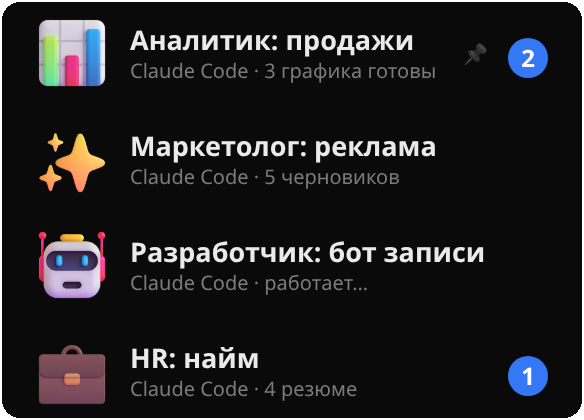
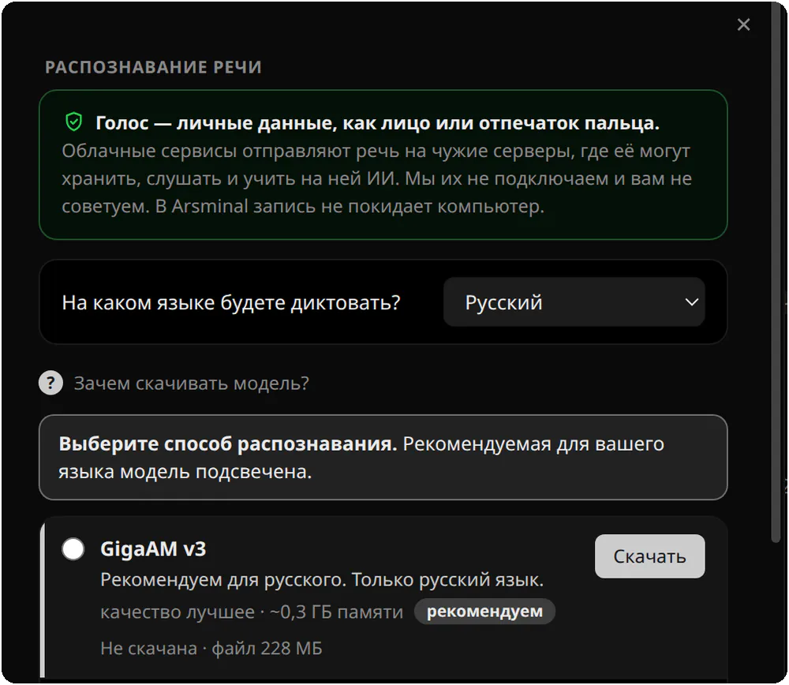
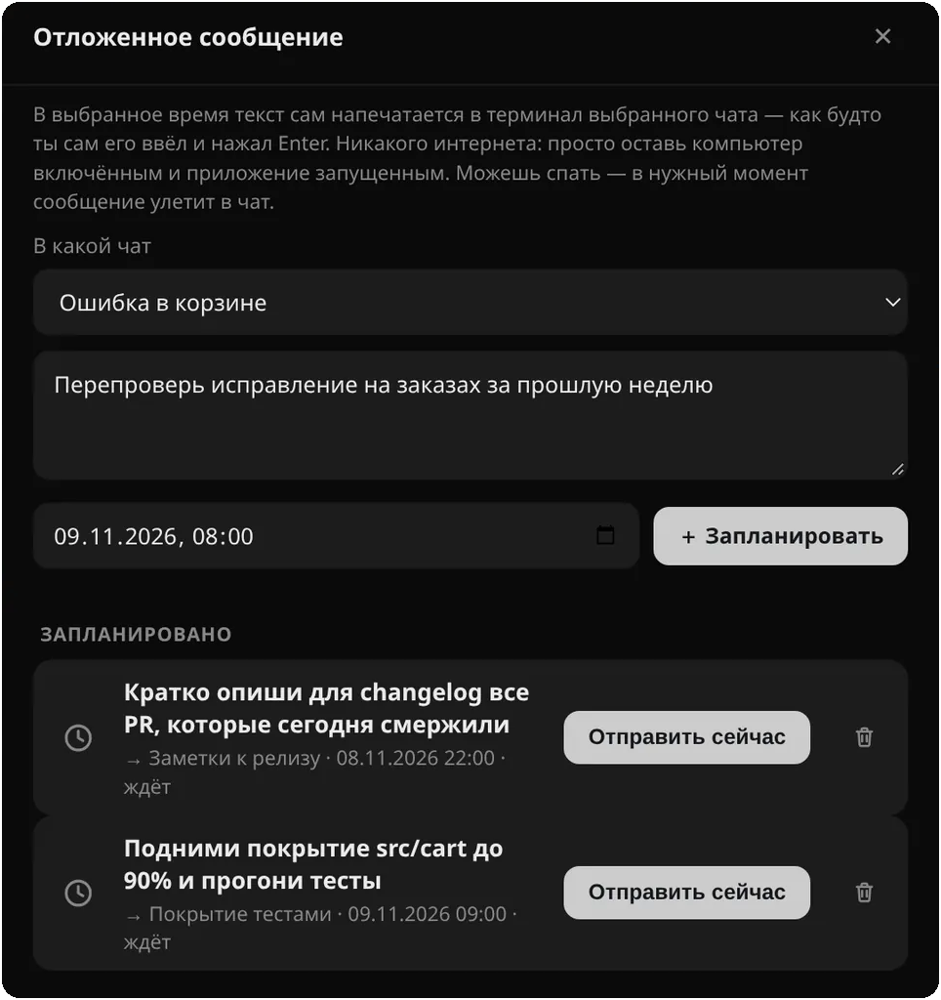
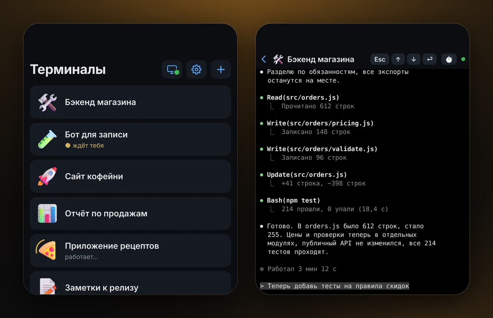
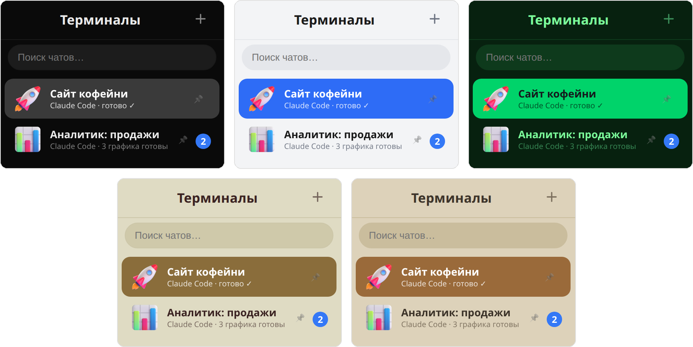

<!-- При каждом новом релизе менять версию во всех ссылках /dl/v1.0.3/ (кнопки скачивания, таблица в разделе «Скачать»). Счётчик /dl/ перенаправляет на тот же файл в GitHub Releases. -->
<p align="center">
  <a href="https://arsminal.com/ru/"></a>
</p>

<h1 align="center">Arsminal</h1>

<p align="center">
  <b>Мессенджер для вашей команды ИИ-агентов</b>
</p>

<p align="center">
  Каждая сессия Claude Code — это чат. Слева чаты, справа переписка.<br>
  Бесплатно для macOS, Windows и Linux.
</p>

<p align="center">
  <a href="https://arsminal.com/dl/v1.0.3/Arsminal-1.0.3-arm64-ru.dmg?s=gh"></a>&nbsp;
  <a href="https://arsminal.com/dl/v1.0.3/Arsminal-Setup-1.0.3-ru.exe?s=gh"></a>&nbsp;
  <a href="https://arsminal.com/dl/v1.0.3/Arsminal-1.0.3-x86_64-ru.AppImage?s=gh"></a>
</p>
<p align="center">
  <sub>Кнопка macOS — для Apple Silicon · <a href="https://arsminal.com/dl/v1.0.3/Arsminal-1.0.3-x64-ru.dmg?s=gh">Intel</a> · <a href="https://github.com/arsentev-ai/arsminal/releases">все версии</a></sub>
</p>

<p align="center">
  <a href="https://github.com/arsentev-ai/arsminal/releases"></a>
  <a href="https://github.com/arsentev-ai/arsminal/releases"></a>
  <a href="#-скачать"></a>
  <a href="LICENSE.txt"></a>
  <a href="https://github.com/arsentev-ai/arsminal/stargazers"></a>
</p>

<p align="center">
  <a href="https://arsminal.com/ru/"><b>Сайт</b></a> &nbsp;·&nbsp;
  <a href="#-возможности"><b>Возможности</b></a> &nbsp;·&nbsp;
  <a href="#-скачать"><b>Скачать</b></a> &nbsp;·&nbsp;
  <a href="#-вопросы-и-ответы"><b>Вопросы</b></a>
</p>

<p align="center">
  <a href="README.md">English</a> &nbsp;·&nbsp; <b>Русский</b> &nbsp;·&nbsp; <a href="README.es.md">Español</a>
</p>

<p align="center">
  <a href="https://arsminal.com/ru/"></a>
</p>

<br>

## 💬 Что это

Arsminal — приложение для компьютера, которое выглядит и ощущается как мессенджер, но внутри каждого чата живёт настоящий терминал с ИИ-агентом. Вы работаете с агентами так же, как переписываетесь с коллегами: слева список чатов, справа разговор. Ни кучи окон терминала, ни лишнего, как в редакторах кода. Пишете или говорите голосом — агенты делают работу.

## 🧭 Зачем я его сделал

**В корпорации у меня в мессенджере были все отделы.** Маркетолог, аналитик, разработчик, HR: каждый — отдельный чат, и я с одного взгляда видел, кто закончил, а кто ждёт меня.

**В стартапе людей и бюджета меньше.** Поэтому мессенджер я оставил, а те же роли отдал агентам: один Claude Code на аналитику, один на рекламу, один на бот записи, один на найм. Они работают одновременно, каждый в своей папке проекта, а я перехожу между ними, как между коллегами.

**Arsminal и есть этот мессенджер.** Один чат на агента, один агент на роль или проект. Сделал его сначала для себя. Теперь он бесплатный для всех.

<br>

## ✨ Возможности

<table>
<tr>
<td width="40%" valign="middle">
<h3>👥 Команда агентов, у каждого свой чат</h3>
<b>Аналитик: продажи</b>, <b>Маркетолог: реклама</b>, <b>Разработчик: бот записи</b>, <b>HR: найм</b>. Каждый — Claude Code в своей папке проекта, со своим именем, ролью и 3D-стикером.
</td>
<td width="60%">

</td>
</tr>
<tr>
<td width="40%" valign="middle">
<h3>🔔 Видно, кто работает, кто закончил, кто ждёт</h3>
Статус прямо под именем: <i>работает…</i>, <i>готово ✓</i>, <i>3 графика готовы</i>. Когда агент в фоновом чате закончил или что-то спросил, этот чат поднимается наверх со счётчиком непрочитанного.
</td>
<td width="60%">

</td>
</tr>
<tr>
<td width="40%" valign="middle">
<h3>⚡ Кнопки вместо команд</h3>
Частые просьбы сохраняются кнопками: <b>Запустить Claude</b>, <b>/usage</b>, <b>/clear</b> или свои. Одно нажатие — и агент получил задачу. Кнопки можно добавлять, переименовывать и перекрашивать.
</td>
<td width="60%">

</td>
</tr>
<tr>
<td width="40%" valign="middle">
<h3>🎤 Скажите, а не печатайте</h3>
Нажмите микрофон и говорите, как будто записываете голосовое. Агент получит задачу текстом и начнёт работать. Речь распознаёт модель на вашем компьютере, запись никуда не уходит.
</td>
<td width="60%">

</td>
</tr>
<tr>
<td width="40%" valign="middle">
<h3>⏰ Отложенные сообщения</h3>
Напишите сейчас, отправьте потом. В назначенное время текст сам напечатается в выбранный чат, как будто вы его ввели и нажали Enter. Агент получит задачу завтра в 9:00, даже если вы спите.
</td>
<td width="60%">

</td>
</tr>
<tr>
<td width="40%" valign="middle">
<h3>📱 Ваши агенты в телефоне</h3>
Отсканируйте QR-код и работайте со всей командой из кафе или парка. Приложение для телефона бесплатное и без аккаунта: <a href="https://arsminal.com/ru/app">iPhone — App Store, Android — APK</a>. Связь зашифрована от начала до конца постквантовым <b>ML-KEM-768</b> поверх X25519.
</td>
<td width="60%">

</td>
</tr>
<tr>
<td width="40%" valign="middle">
<h3>🎨 Темы для дня и ночи</h3>
12 тем, свои обои за любым чатом и режим <b>«Авто»</b>: днём светлая, ночью тёмная, переключается сама.
</td>
<td width="60%">

</td>
</tr>
</table>

- **Каждый чат — живой терминал.** Arsminal запускает официальный Claude Code с вашим аккаунтом. Ничего не проксируется и не переписано заново.
- **Закрепы, архив и поиск.** Важные чаты закрепляются, старые уходят в архив, поиск найдёт любую переписку по слову из неё.
- **Файлы как в мессенджере.** Скрепка, выбрать файл, отправить. Агент получит его прямо в чате.
- **Проекты, а не только код.** Сайт, отчёт по продажам, черновики рекламы, найм, подкаст, поездка: всё, что агент может для вас сделать, — это чат.
- **Бесплатно.** Без рекламы и без подписки. Обновления приходят внутри приложения.

<br>

## 🎨 Темы

<p align="center">
  
</p>

Чёрная для ночи, белая для дня, зелёная Matrix, тёплая бежевая и спокойная тема для уставших глаз. Всего 12 тем, а в режиме **«Авто»** приложение само становится светлым днём и тёмным ночью.

<br>

## 🔒 Ваше остаётся вашим

- **Переписка у вас.** Чаты, файлы и ключи хранятся только на вашем компьютере.
- **Сквозное шифрование до телефона.** ML-KEM, стандарт NIST 2024 года. Сервер связи передаёт байты, которые не может прочитать, и ничего не записывает.
- **Без слежки.** Ни аналитики, ни рекламы, ни продажи данных.

<br>

## 📥 Скачать

<p align="center">
  <a href="https://arsminal.com/dl/v1.0.3/Arsminal-1.0.3-arm64-ru.dmg?s=gh"></a>&nbsp;
  <a href="https://arsminal.com/dl/v1.0.3/Arsminal-Setup-1.0.3-ru.exe?s=gh"></a>&nbsp;
  <a href="https://arsminal.com/dl/v1.0.3/Arsminal-1.0.3-x86_64-ru.AppImage?s=gh"></a>
</p>
<p align="center">
  <sub>Кнопка macOS — для Apple Silicon · <a href="https://arsminal.com/dl/v1.0.3/Arsminal-1.0.3-x64-ru.dmg?s=gh">Intel</a> · <a href="https://github.com/arsentev-ai/arsminal/releases">все версии</a></sub>
</p>

Arsminal полностью бесплатный. Без рекламы и без подписки.

| Платформа | Файл | Где взять |
|---|---|---|
| 🍎 **macOS** · Apple Silicon | `Arsminal-1.0.3-arm64-ru.dmg` | [Скачать](https://arsminal.com/dl/v1.0.3/Arsminal-1.0.3-arm64-ru.dmg?s=gh) · [все версии](https://github.com/arsentev-ai/arsminal/releases) |
| 🍎 **macOS** · Intel | `Arsminal-1.0.3-x64-ru.dmg` | [Скачать](https://arsminal.com/dl/v1.0.3/Arsminal-1.0.3-x64-ru.dmg?s=gh) · [все версии](https://github.com/arsentev-ai/arsminal/releases) |
| 🪟 **Windows** | `Arsminal-Setup-1.0.3-ru.exe` | [Скачать](https://arsminal.com/dl/v1.0.3/Arsminal-Setup-1.0.3-ru.exe?s=gh) · [все версии](https://github.com/arsentev-ai/arsminal/releases) |
| 🐧 **Linux** x86_64 | `Arsminal-1.0.3-x86_64-ru.AppImage` | [Скачать](https://arsminal.com/dl/v1.0.3/Arsminal-1.0.3-x86_64-ru.AppImage?s=gh) · [все версии](https://github.com/arsentev-ai/arsminal/releases) |
| 📱 **Телефон** · iPhone, Android | App Store · APK | [arsminal.com/ru/app](https://arsminal.com/ru/app) |

<p align="center">
  <a href="https://arsminal.com/ru/app"></a>
</p>

**Телефон.** [iPhone — App Store, Android — APK](https://arsminal.com/ru/app): пульт для агентов на вашем компьютере. Бесплатно, без аккаунта, подключается по QR-коду.

**macOS через Homebrew**

```sh
brew install --cask arsentev-ai/tap/arsminal
```

**Подсказка для Windows.** Если при первом запуске SmartScreen показал синее окно, нажмите **«Подробнее» → «Выполнить в любом случае»** (More info → Run anyway). Установщик — тот же файл, что в релизе выше.

**Linux.** Сделайте AppImage исполняемым (`chmod +x`) и запустите. Обновления приходят внутри приложения.

<br>

## ❓ Вопросы и ответы

<details>
<summary><b>Arsminal правда бесплатный?</b></summary>
<br>
Да. Полностью бесплатный, без рекламы и без подписки.
</details>

<details>
<summary><b>Агенты входят в комплект?</b></summary>
<br>
Нет. Arsminal — мессенджер, а агенты ваши. Установите Claude Code как обычно со своим аккаунтом Claude, нажмите в чате <b>«Запустить Claude»</b> — и он работает там.
</details>

<details>
<summary><b>Какие агенты в нём работают?</b></summary>
<br>
В первую очередь Claude Code. Подойдёт и любой агент, который запускается в терминале: OpenAI Codex, Gemini, Grok, DeepSeek, Cursor, GitHub Copilot и локальные агенты на вашем компьютере.
</details>

<details>
<summary><b>Зачем много агентов, а не один?</b></summary>
<br>
По той же причине, по которой в компании больше одного сотрудника. Один агент на роль или проект: маркетолог, аналитик, разработчик. Они работают одновременно, а вы видите, кто закончил и кто ждёт вас.
</details>

<details>
<summary><b>Где хранится переписка?</b></summary>
<br>
Только на вашем компьютере. Связь с телефоном зашифрована от начала до конца, сервер её прочитать не может.
</details>

<details>
<summary><b>Нужно ли уметь программировать?</b></summary>
<br>
Нет. Вы пишете или говорите, что нужно, обычными словами, код пишет агент.
</details>

<details>
<summary><b>Windows, Linux, телефон?</b></summary>
<br>
macOS, Windows и Linux сразу. Для телефона есть своё приложение: iPhone — из App Store, Android — APK. К компьютеру подключается по QR-коду.
</details>

<br>

## 🔗 Ссылки

- **Сайт:** [arsminal.com/ru](https://arsminal.com/ru/) · [English](https://arsminal.com) · [Español](https://arsminal.com/es/)
- **Сравнения:** [Arsminal как альтернатива cmux](https://arsminal.com/cmux-alternative/) · [Arsminal как альтернатива Warp](https://arsminal.com/warp-alternative/) · [Лучший терминал для Claude Code](https://arsminal.com/best-terminal-for-claude-code/)
- **Релизы:** [github.com/arsentev-ai/arsminal/releases](https://github.com/arsentev-ai/arsminal/releases)
- **Политика конфиденциальности:** [arsminal.com/privacy](https://arsminal.com/privacy)

## 👤 Автор


**Евгений Арсентьев** (Evgenii Arsentev), MD, PhD — создатель Arsminal; основатель и CEO Dad4Kids и [arsentev.ai](https://arsentev.ai).  
Каждый день работаю с ИИ-агентами и сделал Arsminal сначала для себя.

[arsentev.ai](https://arsentev.ai) · [Wikidata](https://www.wikidata.org/wiki/Q141398931) · [ORCID](https://orcid.org/0000-0002-9120-7298) · [DOI 10.5281/zenodo.24079643](https://doi.org/10.5281/zenodo.24079643)

<br clear="left">

## 📄 Лицензия

Arsminal — **freeware**: бесплатен для скачивания и использования, но не является программой с открытым исходным кодом. См. [LICENSE.txt](LICENSE.txt).

© 2026 Evgenii Arsentev. Все права защищены.  
Claude, Codex, Gemini, Grok, DeepSeek, Cursor и Copilot — товарные знаки их владельцев. Arsminal с ними не связан.

<p align="center">
  <sub>Если Arsminal вам полезен, ⭐ этому репозиторию поможет другим людям его найти.</sub>
</p>
