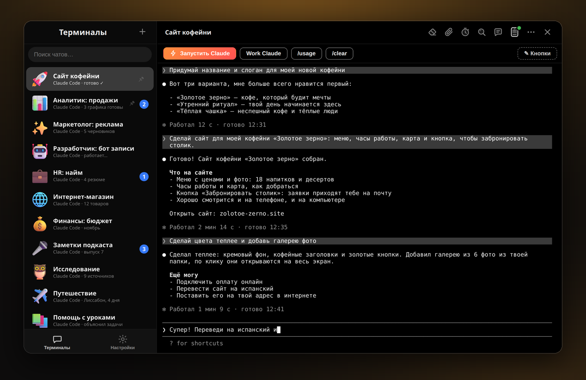
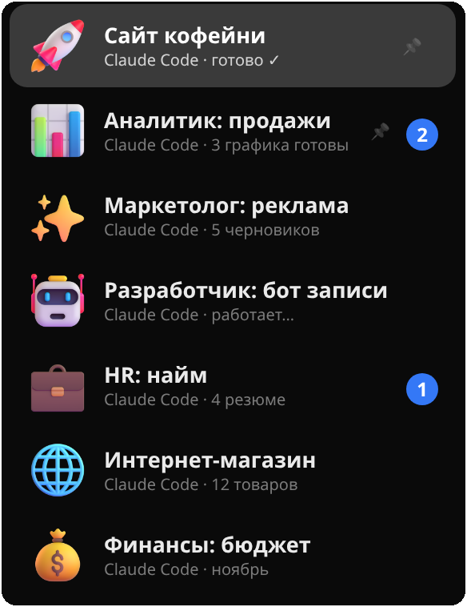
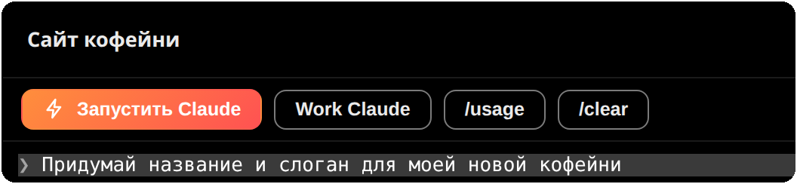
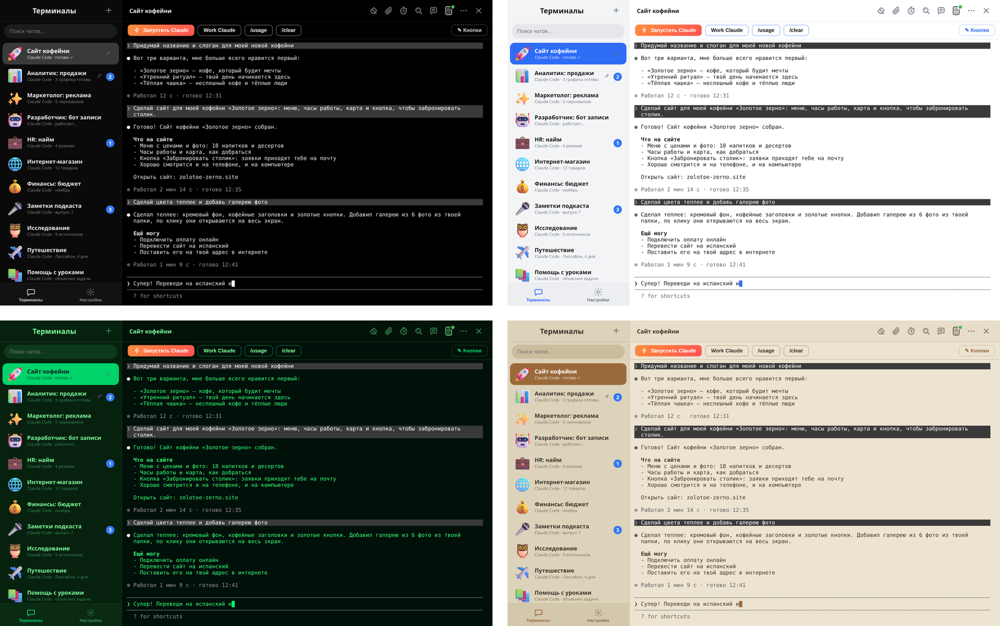

<p align="center">
  <a href="https://arsminal.com/ru/"></a>
</p>

<h1 align="center">Arsminal</h1>

<p align="center">
  <b>Мессенджер для вашей команды ИИ-агентов.</b><br>
  Каждая сессия Claude Code — это чат. Слева чаты, справа переписка.<br>
  Бесплатно для macOS, Windows и Linux.
</p>

<p align="center">
  <a href="https://github.com/arsentev-ai/arsminal/releases/latest"></a>
  <a href="https://github.com/arsentev-ai/arsminal/releases"></a>
  <a href="https://github.com/arsentev-ai/arsminal/releases/latest"></a>
  <a href="LICENSE.txt"></a>
  <a href="https://github.com/arsentev-ai/arsminal/stargazers"></a>
</p>

<p align="center">
  <a href="https://arsminal.com/ru/"><b>Сайт</b></a> &nbsp;·&nbsp;
  <a href="https://github.com/arsentev-ai/arsminal/releases/latest"><b>Скачать</b></a> &nbsp;·&nbsp;
  <a href="#-скачать"><b>Все платформы</b></a> &nbsp;·&nbsp;
  <a href="#-вопросы-и-ответы"><b>Вопросы</b></a>
</p>

<p align="center">
  <a href="README.md">English</a> &nbsp;·&nbsp; <b>Русский</b> &nbsp;·&nbsp; <a href="README.es.md">Español</a>
</p>

<p align="center">
  <a href="https://arsminal.com/ru/"></a>
</p>

<br>

## 💬 Почему мессенджер

Arsminal — приложение для компьютера, которое выглядит и ощущается как мессенджер, но внутри каждого чата живёт настоящий терминал с ИИ-агентом. Вы работаете с агентами так же, как переписываетесь с коллегами: слева список чатов, справа разговор. Ни кучи окон терминала, ни лишнего, как в редакторах кода. Пишете или говорите голосом, работу делают агенты.

> **От автора.** В корпорации у меня в мессенджере были все отделы: маркетолог, аналитик, разработчик, HR. В стартапе людей и бюджета меньше, поэтому мессенджер я оставил, а те же роли отдал агентам. Arsminal и есть этот мессенджер: один чат на агента, один агент на роль или проект. Сделал его сначала для себя. Теперь он бесплатный для всех.

<br>

## 👥 Команда агентов, у каждого свой чат



У каждого агента свой чат с именем, ролью и 3D-стикером: **Аналитик: продажи**, **Маркетолог: реклама**, **Разработчик: бот записи**, **HR: найм**, **Финансы: бюджет**. Все они могут быть Claude Code, каждый в своей папке проекта. Они работают одновременно и не мешают друг другу, а вы переходите между ними, как между коллегами в мессенджере.

- **Каждый чат — живой терминал.** Arsminal запускает официальный Claude Code с вашим аккаунтом. Ничего не проксируется и не переписано заново.
- **Видно, кто работает, кто закончил, кто ждёт.** Когда агент в фоновом чате закончил или что-то спросил, этот чат поднимается наверх со счётчиком непрочитанного.
- **Закрепы, архив и поиск.** Важные чаты закрепляются, старые уходят в архив, поиск найдёт любую переписку по слову из неё.
- **Проекты, а не только код.** Сайт, отчёт по продажам, черновики рекламы, найм, подкаст, поездка: всё, что агент может для вас сделать, — это чат.

<br clear="right">

## 🎤 Скажите, а не печатайте

Нажмите микрофон и скажите, что нужно, как будто записываете голосовое. Агент получит задачу текстом и начнёт работать. Речь распознаётся прямо на вашем компьютере, запись никуда не уходит.

## ⏰ Отложенные сообщения

Напишите сейчас, отправьте потом. Агент получит задачу завтра в 9:00, даже если вы спите.

## ⚡ Кнопки вместо команд

<p align="center">
  
</p>

Частые просьбы сохраняются кнопками. Одно нажатие — и агент получил задачу. Кнопки можно добавлять, переименовывать и перекрашивать. Файл прикладывается как в любом мессенджере: скрепка, выбрать файл, отправить.

## 📱 Ваши агенты в телефоне

Отсканируйте QR-код и работайте со всей командой из кафе или парка. Чаты синхронизированы: начали на компьютере, продолжили с телефона. Отдельное приложение не нужно, всё открывается в браузере.

Связь **зашифрована от начала до конца постквантовым ML-KEM-768 поверх X25519**. Сервер связи передаёт байты, которые не может прочитать, и ничего не записывает. То, что перехватят сегодня, не расшифруют и компьютеры будущего.

## 🎨 Темы для дня и ночи

<p align="center">
  
</p>

Чёрная для ночи, белая для дня, зелёная «Матрица» и спокойная бежевая тема для уставших глаз. Всего 12 тем, свои обои за любым чатом и режим **«Авто»**: днём светлая, ночью тёмная, переключается сама.

## 🔒 Ваше остаётся вашим

- **Переписка у вас.** Чаты, файлы и ключи хранятся только на вашем компьютере.
- **Сквозное шифрование до телефона.** ML-KEM, стандарт NIST 2024 года. Сервер ничего не видит.
- **Без слежки.** Ни аналитики, ни рекламы, ни продажи данных.

<br>

## 📥 Скачать

Arsminal полностью бесплатный. Без рекламы и без подписки.

| Платформа | Файл | Где взять |
|---|---|---|
| 🍎 **macOS** · Apple Silicon | `Arsminal-<версия>-arm64.dmg` | [Последний релиз](https://github.com/arsentev-ai/arsminal/releases/latest) · [arsminal.com/ru](https://arsminal.com/ru/) |
| 🍎 **macOS** · Intel | `Arsminal-<версия>-x64.dmg` | [Последний релиз](https://github.com/arsentev-ai/arsminal/releases/latest) · [arsminal.com/ru](https://arsminal.com/ru/) |
| 🪟 **Windows** | `Arsminal-Setup-<версия>.exe` | [Последний релиз](https://github.com/arsentev-ai/arsminal/releases/latest) · [arsminal.com/ru](https://arsminal.com/ru/) |
| 🐧 **Linux** x86_64 | `Arsminal-<версия>-x86_64.AppImage` | [Последний релиз](https://github.com/arsentev-ai/arsminal/releases/latest) · [arsminal.com/ru](https://arsminal.com/ru/) |

**macOS через Homebrew:**  

```sh
brew install --cask arsentev-ai/tap/arsminal
```

**Подсказка для Windows.** Если при первом запуске SmartScreen показал синее окно, нажмите **«Подробнее» → «Выполнить в любом случае»** (More info → Run anyway). Установщик — тот же файл, что в релизе выше.

**Linux.** Сделайте AppImage исполняемым (`chmod +x`) и запустите. Обновления приходят внутри приложения.

<br>

## ❓ Вопросы и ответы

**Arsminal правда бесплатный?**  
Да. Полностью бесплатный, без рекламы и без подписки.

**Агенты входят в комплект?**  
Нет. Arsminal — мессенджер, а агенты ваши. Установите Claude Code как обычно со своим аккаунтом Claude, нажмите в чате **«Запустить Claude»** — и он работает там.

**Какие агенты в нём работают?**  
В первую очередь Claude Code. Подойдёт и любой агент, который запускается в терминале: OpenAI Codex, Gemini, Grok, DeepSeek, Cursor, GitHub Copilot и локальные агенты на вашем компьютере.

**Зачем много агентов, а не один?**  
По той же причине, по которой в компании больше одного сотрудника. Один агент на роль или проект: маркетолог, аналитик, разработчик. Они работают одновременно, а вы видите, кто закончил и кто ждёт вас.

**Где хранится переписка?**  
Только на вашем компьютере. Связь с телефоном зашифрована от начала до конца, сервер её прочитать не может.

**Нужно ли уметь программировать?**  
Нет. Вы пишете или говорите, что нужно, обычными словами, код пишет агент.

**Windows, Linux, телефон?**  
macOS, Windows и Linux сразу. Телефон подключается по QR-коду в браузере, отдельное приложение не нужно.

<br>

## 🔗 Ссылки

- **Сайт:** [arsminal.com/ru](https://arsminal.com/ru/) · [English](https://arsminal.com) · [Español](https://arsminal.com/es/)
- **Сравнения:** [Arsminal как альтернатива cmux](https://arsminal.com/cmux-alternative/) · [Arsminal как альтернатива Warp](https://arsminal.com/warp-alternative/) · [Лучший терминал для Claude Code](https://arsminal.com/best-terminal-for-claude-code/)
- **Релизы:** [github.com/arsentev-ai/arsminal/releases](https://github.com/arsentev-ai/arsminal/releases)
- **Политика конфиденциальности:** [arsminal.com/privacy](https://arsminal.com/privacy)

## 👤 Автор


**Евгений Арсентьев** (Evgenii Arsentev), MD, PhD — создатель Arsminal; основатель и CEO Dad4Kids и [arsentev.ai](https://arsentev.ai).  
Каждый день работаю с ИИ-агентами и сделал Arsminal сначала для себя.

[arsentev.ai](https://arsentev.ai) · [Wikidata](https://www.wikidata.org/wiki/Q141398931) · [ORCID](https://orcid.org/0000-0002-9120-7298) · [DOI 10.5281/zenodo.24079643](https://doi.org/10.5281/zenodo.24079643)

<br clear="left">

## 📄 Лицензия

Arsminal — **freeware**: бесплатен для скачивания и использования, но не является программой с открытым исходным кодом. См. [LICENSE.txt](LICENSE.txt).

© 2026 Evgenii Arsentev. Все права защищены.  
Claude, Codex, Gemini, Grok, DeepSeek, Cursor и Copilot — товарные знаки их владельцев. Arsminal с ними не связан.

<p align="center">
  <sub>Если Arsminal вам полезен, ⭐ этому репозиторию поможет другим людям его найти.</sub>
</p>
